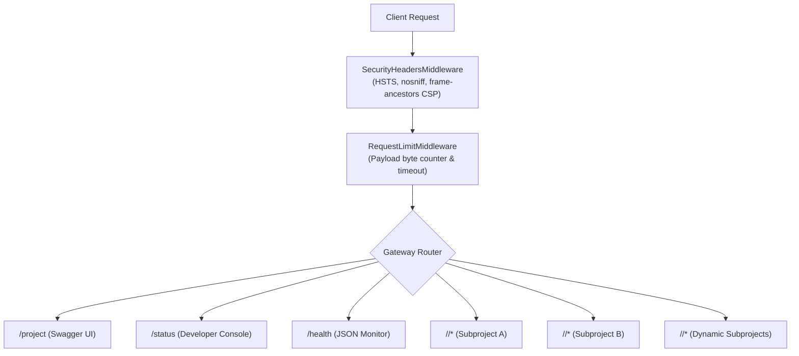

# HF Backend: Pluggable API Gateway

An aggregation gateway that hosts and monitors multiple Python subprojects within a single container on Hugging Face Spaces.

The gateway mounts standalone package routers under dedicated URL prefixes, providing shared infrastructure: build-time model prefetching, memory warmups at boot, streaming payload guards, security headers, unified Swagger UI documentation, and health telemetry.

Read [ARCHITECTURE.md](file:///c:/Users/manga/Projects/github/rachit-mangawa/hf-backend/ARCHITECTURE.md) for technical specifications, build caching mechanics, and subproject integration contracts.

---

## Quick links

| Resource | Path | Description |
| :--- | :--- | :--- |
| Interactive API docs | [`/` or `/project`](file:///c:/Users/manga/Projects/github/rachit-mangawa/hf-backend/main.py#L236) | Swagger UI documenting all mounted subproject routes |
| Frontend Portal | [`frontend/`](frontend/index.html) | Interactive showcase deployed to GitHub Pages |
| Developer console | [`/status`](file:///c:/Users/manga/Projects/github/rachit-mangawa/hf-backend/main.py#L220) | Real-time status console with endpoint explorer and cURL snippets |
| Health endpoint | [`/health`](file:///c:/Users/manga/Projects/github/rachit-mangawa/hf-backend/main.py#L201) | Machine-readable JSON health and readiness payload |
| OpenAPI schema | `/openapi.json` | OpenAPI 3.1 specification |

---

## Core architecture

The gateway maintains no domain-specific business logic. Each subproject is maintained in its own repository, installs as a standard Python package, and exports a FastAPI `APIRouter`.



If any registered service fails to import or encounters an error during startup warmup, the gateway records the error, marks overall health as `degraded`, and continues serving all other healthy subprojects without interruption.

---

## Mounting a new service

Mounting any Python package takes two steps:

### 1. Register the route prefix
Add the desired path prefix and router import string to `registry.py`:

```python
PROJECT_REGISTRY = {
    "/my-service": "my_package.router:router",
    "/vision": "cv_module.api:router",
}
```

The import format follows standard setuptools entrypoint syntax: `<module_path>:<router_attribute_name>`.

### 2. Declare the dependency
Add the package source (git tag, PyPI release, or wheel URL) to `requirements.in`:

```text
git+https://github.com/<owner>/<repo>.git@v1.0#subdirectory=backend
```

Compile `requirements.txt` using `uv` or `pip-compile`:

```bash
uv pip compile requirements.in -o requirements.txt --python-version 3.11 --python-platform linux --extra-index-url https://download.pytorch.org/whl/cpu --emit-index-url
```

When changes land on `main`, the build pipeline installs the dependency, prefetches any model checkpoints declared in its `warmup()` function, and hot-mounts the router.

---

## Subproject contract

For a subproject to mount cleanly into the gateway, it satisfies two conventions:

### 1. Router export
The package exports a standard FastAPI `APIRouter`:

```python
# my_package/router.py
from fastapi import APIRouter

router = APIRouter()

@router.get("/health")
def service_health():
    return {"status": "ok"}
```

### 2. Startup warmup (optional)
If the subproject depends on large weights (Transformers, PyTorch, Scikit-learn, ONNX), it can expose a top-level callable named `warmup()`:

```python
# my_package/__init__.py
def warmup():
    # Load tokenizers and model weights into memory
    # Run a synthetic inference pass to compile compute graphs
    pass
```

During the Docker build step, `prefetch.py` calls `warmup()` to download model files directly into `/home/user/hf-cache`, baking them into the container layer. At container boot, the gateway calls `warmup()` in a worker thread before opening port 7860, ensuring first-request response times stay below 100ms.

---

## Reference deployments

As demonstration implementations, this repository currently mounts two reference subprojects:

| Route Prefix | Service | Source Repository | Capabilities |
| :--- | :--- | :--- | :--- |
| `/heartflow` | HeartFlow OS | [`rachit-mangawa/HEARTFLOW_OS`](https://github.com/rachit-mangawa/HEARTFLOW_OS) | Vitals risk scoring, SHAP explainability, TinyML C export, model retraining |
| `/semantic` | Semantic Analyzer | [`rachit-mangawa/Semantic-Comment-Analyze`](https://github.com/rachit-mangawa/Semantic-Comment-Analyze) | RoBERTa sentiment analysis, intent classification, CSV batch streaming |

---

## Environment configuration

Configure these settings in the Hugging Face Space under **Settings > Variables and secrets**:

| Variable | Default | Purpose |
| :--- | :--- | :--- |
| `ENABLE_DOCS` | `true` | Enables or disables Swagger UI at `/project` and `/openapi.json`. |
| `DOCS_URL` | `/project` | URL path where Swagger UI is served. |
| `OPENAPI_URL` | `/openapi.json` | URL path where the OpenAPI specification is served. |
| `CORS_ALLOWED_ORIGINS` | *(localhost, Vercel)* | Comma-separated list of origins allowed for cross-origin requests. |
| `DISABLE_PROJECTS` | *(none)* | Comma-separated router prefixes to skip at boot (e.g. `semantic`). |
| `MAX_BODY_SIZE_BYTES` | `10485760` (10 MB) | Maximum incoming request body size before returning HTTP 413. |
| `REQUEST_TIMEOUT_SECONDS` | `60.0` | Timeout per request before returning HTTP 504. |
| `WARMUP_TIMEOUT_SECONDS` | `300.0` | Maximum time allowed for each package warmup call at boot. |
| `GITHUB_TOKEN` | *(none)* | Personal access token used during Docker build to clone private repos. |

---

## Developer console & telemetry

Visiting the root `/` or `/status` renders the developer console. It dynamically queries the gateway state and exposes:
* Live ping latency meter with a manual refresh control and a 10-second auto-poll toggle.
* Dynamic route explorer listing mounted paths, HTTP method badges (`GET`, `POST`, `WS`), and one-click cURL snippet generators.
* Keyboard-driven route search (`/`) across all registered prefixes and endpoint paths.
* Gateway configuration summary detailing active security headers and stream metering limits.
* Formatted view of the `/health` payload with one-click copy.

---

## Security controls

* Security headers applied by `SecurityHeadersMiddleware` on every response:
  * `X-Content-Type-Options: nosniff` to prevent MIME-sniffing exploits.
  * `X-XSS-Protection: 0` to disable problematic legacy browser XSS filters.
  * `Referrer-Policy: strict-origin-when-cross-origin` to protect referrer context.
  * `Content-Security-Policy: frame-ancestors 'self' https://huggingface.co https://*.hf.space;` allowing the Hugging Face Space UI to embed the page while blocking third-party clickjacking.
  * `Strict-Transport-Security` added automatically on HTTPS connections.
* Early size validation inspects `Content-Length` headers immediately, returning HTTP 413 before large payloads enter application memory, and rejects malformed headers with HTTP 400.
* Chunk stream metering counts arriving bytes on unbuffered streams to catch oversized uploads that omit `Content-Length`.
* Worker protection wraps downstream route execution in an `asyncio` timeout so hung tasks do not exhaust server workers.

---

## Local development

```bash
# Create and activate virtual environment
python -m venv .venv
source .venv/bin/activate  # On Windows: .venv\Scripts\activate

# Install dependencies
pip install -r requirements.txt

# Run the gateway locally
uvicorn main:app --reload --port 7860

# Run automated tests
pytest tests
```
