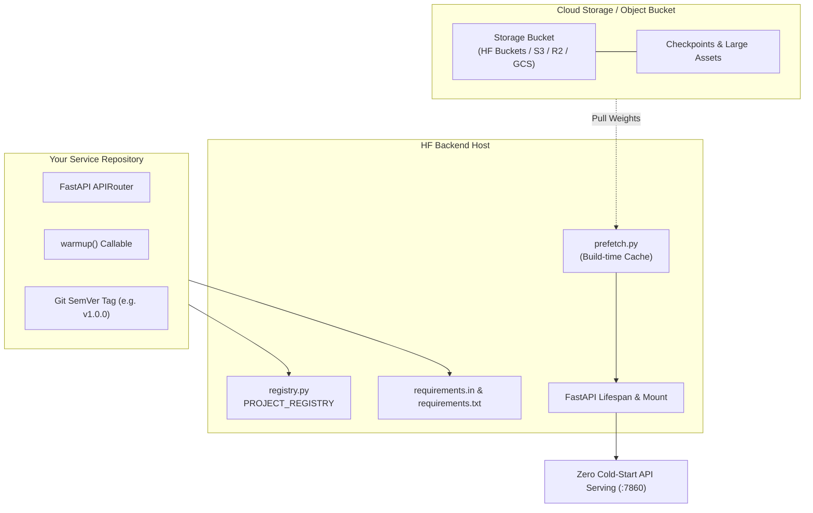
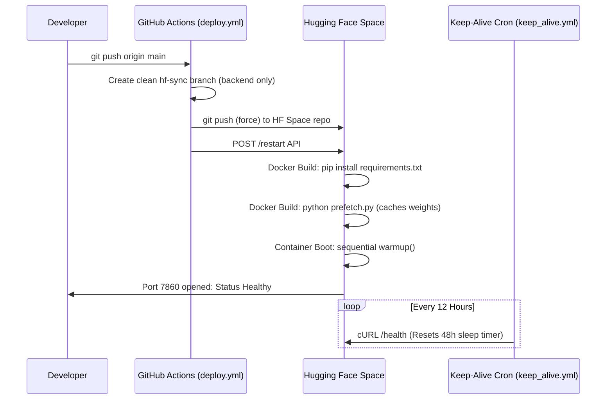
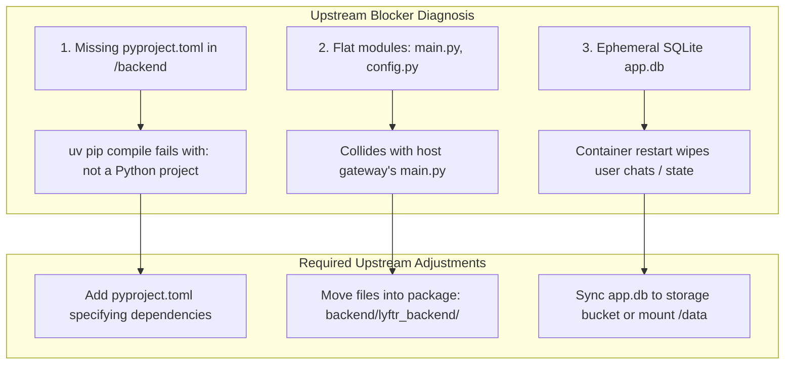

# Subproject Integration & Deployment Guide (`Upload.md`)

This guide provides end-to-end instructions for preparing, packaging, uploading, and deploying any new microservice or subproject to the `hf-backend` gateway hosted on Hugging Face Spaces.

---

## Architecture at a glance

`hf-backend` is an aggregation host. Rather than holding domain-specific logic, it dynamically mounts multiple independent Python microservices under dedicated route prefixes (such as `/heartflow`, `/semantic`, or your new service).



---

## 1. Subproject contract

To integrate cleanly into `hf-backend`, every subproject repository must satisfy three core conventions:

### A. FastAPI `APIRouter` export
Your subproject must expose an instance of FastAPI's `APIRouter` in setuptools entrypoint syntax (`<module_path>:<router_attr>`):

```python
# your_package/router.py
from fastapi import APIRouter

router = APIRouter()

@router.get("/health")
def health():
    return {
        "status": "healthy",
        "service": "your_package",
        "models_loaded": True
    }

@router.post("/predict")
def predict(payload: dict):
    # Your core inference or business logic
    return {"result": "ok"}
```

> [!TIP]
> Keep route paths inside your `APIRouter` relative (e.g. `/predict`, not `/my-service/predict`). The host gateway automatically applies your service prefix when mounting.

### B. Dedicated `/health` endpoint
The host gateway expects each subproject router to provide a `GET /health` endpoint (e.g. `/my-service/health`). This endpoint should return a JSON status indicating whether internal components and model weights are ready.

### C. Optional startup `warmup()` function
If your service loads machine learning models (PyTorch, Transformers, ONNX, Scikit-learn), define a top-level callable named `warmup()` in your package's `__init__.py`:

```python
# your_package/__init__.py
import os
from .router import router

def warmup():
    """
    1. Loads weights into memory (or downloads them from the storage bucket).
    2. Runs a single warm-up pass to compile execution graphs.
    """
    import torch
    # e.g., load model weights into global memory
    print("Pre-warming model weights into memory...")
```

#### Why `warmup()` matters:
1. **Build-Time Baking (`prefetch.py`)**: During the Docker image build on Hugging Face Spaces, `prefetch.py` calls `warmup()` to download weights into `/home/user/hf-cache`. Weights are baked directly into the container image layer, avoiding runtime downloads.
2. **Boot-Time Compilation**: During FastAPI startup lifespan, the gateway executes `warmup()` in a background worker before opening port 7860, eliminating first-request latency.

---

## 2. Storage bucket configuration & asset management

Large model checkpoints or dataset files should never be committed directly to Git. Instead, store them in an object storage bucket. `hf-backend` supports **Hugging Face Storage Buckets**, **AWS S3**, **Cloudflare R2**, **Google Cloud Storage**, and **MinIO**.

### A. Hugging Face Storage Buckets (`hf://buckets/...`)
Hugging Face Storage Buckets provide high-throughput, non-versioned mutable object storage with byte-level deduplication powered by Xet.

#### 1. Create a Bucket via Hugging Face CLI:
```bash
# Install Hugging Face CLI
pip install --upgrade huggingface_hub

# Authenticate
hf login

# Create bucket
hf buckets create <your-hf-username>/<bucket-name>
```

#### 2. Upload Model Checkpoints or Datasets:
```bash
# Sync local weights folder to HF Bucket
hf sync ./weights hf://buckets/<your-hf-username>/<bucket-name>/weights
```

#### 3. Programmatic Access via Python:
```python
from huggingface_hub import hffs
import os

bucket_name = os.getenv("STORAGE_BUCKET_NAME", "your-hf-username/your-bucket-name")
files = hffs.ls(f"buckets/{bucket_name}/weights", detail=False)
print("Available model checkpoints:", files)
```

---

### B. S3-Compatible Storage (Cloudflare R2, AWS S3, MinIO)
If using standard S3 or Cloudflare R2, upload assets using AWS CLI or `boto3`:

```bash
# Sync files to S3 bucket
aws s3 sync ./weights s3://<your-bucket-name>/weights/ \
  --endpoint-url <your-endpoint-url>
```

---

### C. Configuring Bucket Environment Variables
Set these variables in the Hugging Face Space under **Settings > Variables and secrets**:

| Environment Variable | Description | Example |
| :--- | :--- | :--- |
| `STORAGE_BUCKET_NAME` / `BUCKET_NAME` | Name or URI of the bucket | `rachit-mangawa/hf-backend-storage` or `my-bucket` |
| `STORAGE_ENDPOINT_URL` / `S3_ENDPOINT_URL` | Custom S3/HF endpoint URL | `https://s3.hf.co` or Cloudflare R2 endpoint |
| `STORAGE_REGION` / `AWS_REGION` | Storage bucket region | `us-east-1` or `auto` |
| `STORAGE_ACCESS_KEY_ID` | Storage access key ID (Secret) | `HFAK...` or AWS Access Key |
| `STORAGE_SECRET_ACCESS_KEY` | Storage secret access key (Secret) | Secret key |
| `HF_TOKEN` | Hugging Face User Access Token (Secret) | `hf_...` |

The gateway automatically detects these variables, reports their status on the `/status` developer console, and makes them accessible to any subproject via `os.getenv()`.

---

## 3. Packaging & releasing your subproject

Deploying a subproject does not require publishing to public PyPI. You can install directly from a Git tag or branch in your subproject repository.

### Step 1: Ensure valid Python package layout
In your subproject repository:
```text
my-subproject/
├── backend/
│   ├── pyproject.toml (or setup.py)
│   └── my_package/
│       ├── __init__.py      # exports warmup()
│       └── router.py        # exports router = APIRouter()
```

Sample minimal `pyproject.toml`:
```toml
[build-system]
requires = ["setuptools>=61.0"]
build-backend = "setuptools.build_meta"

[project]
name = "my_package"
version = "1.0.0"
dependencies = [
    "fastapi",
    "torch"
]
```

### Step 2: Push code and create a SemVer Git tag
```bash
git add .
git commit -m "feat: release version 1.0.0"
git tag -a v1.0.0 -m "Release v1.0.0"
git push origin main --tags
```

> [!NOTE]
> If your subproject repository is **private**, ensure the `GITHUB_TOKEN` secret is configured in the Hugging Face Space settings. The Docker build pipeline uses this token to authenticate during `pip install`.

---

## 4. Integrating into `hf-backend` (Deployment Walkthrough)

Once your subproject repository is tagged, integrate it into `hf-backend` in five simple steps:

### Step 1: Declare the dependency in `requirements.in`
Open [`requirements.in`](file:///c:/Users/manga/Projects/github/rachit-mangawa/hf-backend/requirements.in) and append your Git URL with tag and optional subdirectory:

```text
git+https://github.com/<owner>/<repo>.git@v1.0.0#subdirectory=backend
```

### Step 2: Recompile `requirements.txt`
Compile the pinned dependency graph using `uv` (fastest) or `pip-compile`:

```bash
uv pip compile requirements.in -o requirements.txt --python-version 3.11 --python-platform linux --extra-index-url https://download.pytorch.org/whl/cpu --emit-index-url --refresh
```

### Step 3: Register route prefix in `registry.py`
Open [`registry.py`](file:///c:/Users/manga/Projects/github/rachit-mangawa/hf-backend/registry.py) and add your entry:

```python
PROJECT_REGISTRY = {
    "/semantic": "semantic_backend.router:router",
    "/heartflow": "heartflow_backend.router:router",
    "/my-service": "my_package.router:router",  # <--- Your new service
}
```

### Step 4: Run local test suite
Verify router resolution and mock loading:

```bash
pytest tests/test_host.py -v
```

### Step 5: Commit and push to `main`
```bash
git add requirements.in requirements.txt registry.py
git commit -m "feat(deploy): mount my-service v1.0.0"
git push origin main
```

---

## 5. Deployment automation & Space lifecycle

Once pushed to `main`, GitHub Actions handles everything automatically:



### Key Automated Behaviors:
1. **Clean Branch Sync (`.github/workflows/deploy.yml`)**: Isolates pure backend files on an orphan branch (`hf-sync`), excluding GitHub Pages and frontend files to comply with Hugging Face Space constraints.
2. **Layer-Cached Docker Build**: `prefetch.py` caches weights into `/home/user/hf-cache`. Subsequent restarts reuse this cached layer.
3. **Automated Keep-Alive (`.github/workflows/keep_alive.yml`)**: Runs every 12 hours (`15 */12 * * *`) with retry backoff to ping `/health`, preventing the free-tier Hugging Face Space from entering its 48-hour idle sleep.
4. **Weekly Upstream Dependency Scanner (`.github/workflows/rebuild_packages.yml`)**: Scans all `git+` repositories in `requirements.in` every Sunday, detects newly published Git tags, updates `requirements.in`, recompiles `requirements.txt`, runs quality tests, and commits updates.

---

## 6. Automatic frontend showcase & website synchronization

Any new subproject you deploy automatically appears on the website ([https://rachit-mangawa.github.io/hf-backend/](https://rachit-mangawa.github.io/hf-backend/)) without having to write or edit any HTML or JavaScript:

### How Automatic Website Updates Work:

1. **Workflow Build-Time Auto-Discovery (`.github/workflows/deploy_pages.yml`)**:
   * Whenever you push changes to `registry.py`, `requirements.in`, or when `deploy.yml` completes, GitHub Actions triggers the frontend deployment workflow.
   * The workflow executes `python scripts/generate_frontend_registry.py`, which parses `registry.py` and `requirements.in`.
   * It outputs `frontend/registry.json`, auto-generating service titles, repository links, route tags, and capability badges.
   * GitHub Pages is deployed automatically with the updated registry.

2. **Client-Side Live OpenAPI Auto-Mounting (`frontend/js/app.js`)**:
   * On page load, `app.js` reads `registry.json` and immediately mounts service cards in the **Mounted Services** grid (`#services-grid`).
   * `app.js` also queries `GET /openapi.json` directly from the live Hugging Face Space.
   * It parses all operations belonging to your route prefix, auto-generating sample request payloads, response schemas, and interactive Swagger-style test consoles under a dedicated gateway tab.
   * Visitors can click **"Try Endpoint"** directly on your service card to open your live endpoints in the interactive console.

3. **Optional Customization**:
   * If you wish to customize your service's logo, specs, or detailed paragraph description in the future, you can optionally edit its metadata entry in `scripts/generate_frontend_registry.py`. Custom values are preserved automatically across builds.

---

## 7. Verification & troubleshooting checklist

After deployment, check the following URLs:

* **Dedicated Project APIs & Docs**: `https://<hf-user>-<space-name>.hf.space/<project-prefix>` (e.g. `/heartflow`, `/semantic`, or your new project prefix)
* **Root Entrypoint**: `https://<hf-user>-<space-name>.hf.space/` (returns an empty message `{"message": ""}`)
* **Developer Console**: `https://<hf-user>-<space-name>.hf.space/status`
* **JSON Health Check**: `https://<hf-user>-<space-name>.hf.space/health`

### Troubleshooting Common Issues

| Symptom | Cause | Solution |
| :--- | :--- | :--- |
| `health["status"] == "degraded"` | Router failed to import or warmup timed out | Check `health["failed"]` and `health["warm_status"]` in `/health` or on the `/status` console. |
| HTTP 413 Payload Too Large | Inbound request exceeded limit | Increase `MAX_BODY_SIZE_BYTES` (default: 10 MB). |
| HTTP 504 Request Timeout | Inference took longer than gateway limit | Increase `REQUEST_TIMEOUT_SECONDS` (default: 60s). |
| Warmup TimeoutError | Model downloading or loading exceeded limit | Increase `WARMUP_TIMEOUT_SECONDS` (default: 300s). |
| CORS Header Missing | Request origin not in whitelist | Add origin to `CORS_ALLOWED_ORIGINS` in Space settings. |
| Temporary Kill Switch | A subproject is broken and needs to be disabled | Add prefix to `DISABLE_PROJECTS` (e.g. `DISABLE_PROJECTS=my-service`). |

---

## 8. Case study & blueprint: Registering stateful microservices (e.g. Lyftr AI)

When attempting to register an external full-stack or backend repository such as [`https://github.com/rachit-mangawa/Lyftr_AI_Full_Stack_Assignment`](https://github.com/rachit-mangawa/Lyftr_AI_Full_Stack_Assignment), three common pitfalls arise:



### Why registering `Lyftr_AI_Full_Stack_Assignment` failed directly:
1. **No packaging metadata**: The `backend/` directory had no `pyproject.toml` or `setup.py`. When `uv pip compile` or `pip install` encounters `git+https://...#subdirectory=backend`, it aborts with:
   ```text
   error: backend does not appear to be a Python project, as neither pyproject.toml nor setup.py are present
   ```
2. **Top-level namespace collisions**: `backend/` contained flat files (`main.py`, `config.py`, `database.py`). If installed as top-level Python modules, `main.py` collides with `hf-backend`'s own root `main.py`.
3. **Ephemeral storage & SQLite persistence**: Lyftr writes conversation threads to SQLite (`app.db`). In Hugging Face Spaces free-tier, the filesystem is ephemeral and wipes on idle restart or container redeployment.

---

### Step-by-step blueprint to package & register Lyftr AI

Follow these steps in your `Lyftr_AI_Full_Stack_Assignment` repository:

#### Step 1: Restructure `backend/` into a namespaced Python package
Move the flat `.py` files inside a dedicated package directory, e.g., `backend/lyftr_backend/`:

```text
Lyftr_AI_Full_Stack_Assignment/
├── backend/
│   ├── pyproject.toml                   <-- REQUIRED packaging manifest
│   └── lyftr_backend/                   <-- Dedicated namespace (prevents collisions)
│       ├── __init__.py                  <-- Exposes warmup() and exports
│       ├── main.py                      <-- Exports app or router
│       ├── config.py
│       ├── database.py                  <-- SQLite configuration
│       └── llm_gateway.py
```

#### Step 2: Add `backend/pyproject.toml`
Create `backend/pyproject.toml` with setuptools build configuration and all upstream dependencies:

```toml
[build-system]
requires = ["setuptools>=61.0"]
build-backend = "setuptools.build_meta"

[project]
name = "lyftr_backend"
version = "1.0.0"
description = "Lyftr AI Full Stack Backend Microservice"
requires-python = ">=3.11"
dependencies = [
    "fastapi>=0.115.0",
    "litellm>=1.50.0",
    "orjson>=3.10.0",
    "soundfile>=0.12.0",
    "pydantic>=2.0.0",
    "python-dotenv>=1.0.0",
]

[tool.setuptools.packages.find]
where = ["."]
include = ["lyftr_backend*"]
```

#### Step 3: Configure stateful SQLite database storage
Choose one of two strategies to persist SQLite data across Space restarts:

##### Option A: Hugging Face Persistent Storage Volume (`/data`)
If your Space has a persistent storage disk attached, configure your SQLite database path in `database.py`:

```python
import os
from pathlib import Path

# /data is persistent on Hugging Face Spaces with disk storage enabled; fall back to local for dev
STORAGE_DIR = Path("/data") if Path("/data").exists() else Path("./data")
STORAGE_DIR.mkdir(parents=True, exist_ok=True)

DB_PATH = STORAGE_DIR / "app.db"
DATABASE_URL = f"sqlite:///{DB_PATH}"
```

##### Option B: Cloud Storage Bucket Sync via `storage.py` (Default for Free Tier)
Use the gateway's `storage.py` helper to restore the database from your storage bucket on startup and snapshot it back:

```python
# lyftr_backend/__init__.py
from storage import download_from_bucket, upload_to_bucket
from pathlib import Path

LOCAL_DB_PATH = Path("/tmp/lyftr_app.db")
REMOTE_DB_KEY = "lyftr/app.db"

def warmup():
    """Restores database state from bucket on cold boot."""
    if not LOCAL_DB_PATH.exists():
        print(f"Syncing {REMOTE_DB_KEY} from bucket to {LOCAL_DB_PATH}...")
        download_from_bucket(REMOTE_DB_KEY, LOCAL_DB_PATH)

def persist_database():
    """Uploads updated database back to bucket."""
    if LOCAL_DB_PATH.exists():
        upload_to_bucket(LOCAL_DB_PATH, REMOTE_DB_KEY)
```

#### Step 4: Tag and push the upstream release
In `Lyftr_AI_Full_Stack_Assignment`:
```bash
git add backend/
git commit -m "feat(pkg): package backend as lyftr_backend with pyproject.toml and bucket sync"
git tag -a v1.0.0 -m "Release v1.0.0 for hf-backend deployment"
git push origin main --tags
```

#### Step 5: Register into `hf-backend`
Once tagged upstream, register it in `hf-backend`:

1. **Add to [`requirements.in`](file:///c:/Users/manga/Projects/github/rachit-mangawa/hf-backend/requirements.in)**:
   ```text
   git+https://github.com/rachit-mangawa/Lyftr_AI_Full_Stack_Assignment.git@v1.0.0#subdirectory=backend
   ```

2. **Recompile [`requirements.txt`](file:///c:/Users/manga/Projects/github/rachit-mangawa/hf-backend/requirements.txt)**:
   ```bash
   uv pip compile requirements.in -o requirements.txt --python-version 3.11 --python-platform linux --extra-index-url https://download.pytorch.org/whl/cpu --emit-index-url --refresh
   ```

3. **Register in [`registry.py`](file:///c:/Users/manga/Projects/github/rachit-mangawa/hf-backend/registry.py)**:
   ```python
   PROJECT_REGISTRY = {
       "/semantic": "semantic_backend.router:router",
       "/heartflow": "heartflow_backend.router:router",
       "/lyftr": "lyftr_backend.main:app",  # Automatically mounts under /lyftr
   }
   ```

4. **Verify & Deploy**:
   ```bash
   pytest tests/test_host.py -v
   git add requirements.in requirements.txt registry.py
   git commit -m "feat: register lyftr microservice"
   git push origin main
   ```

